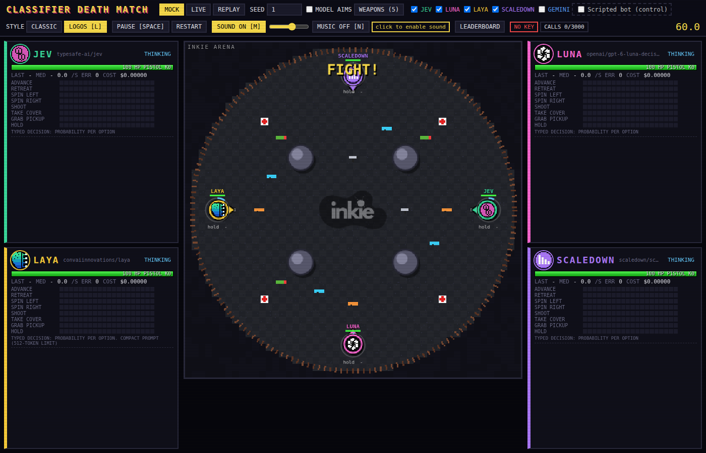
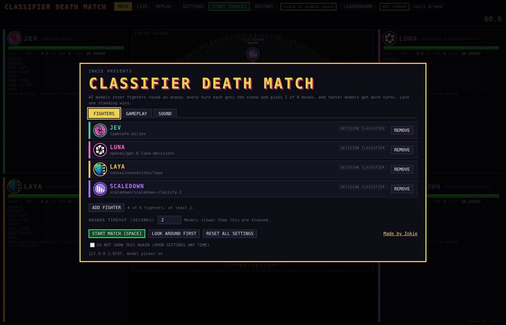
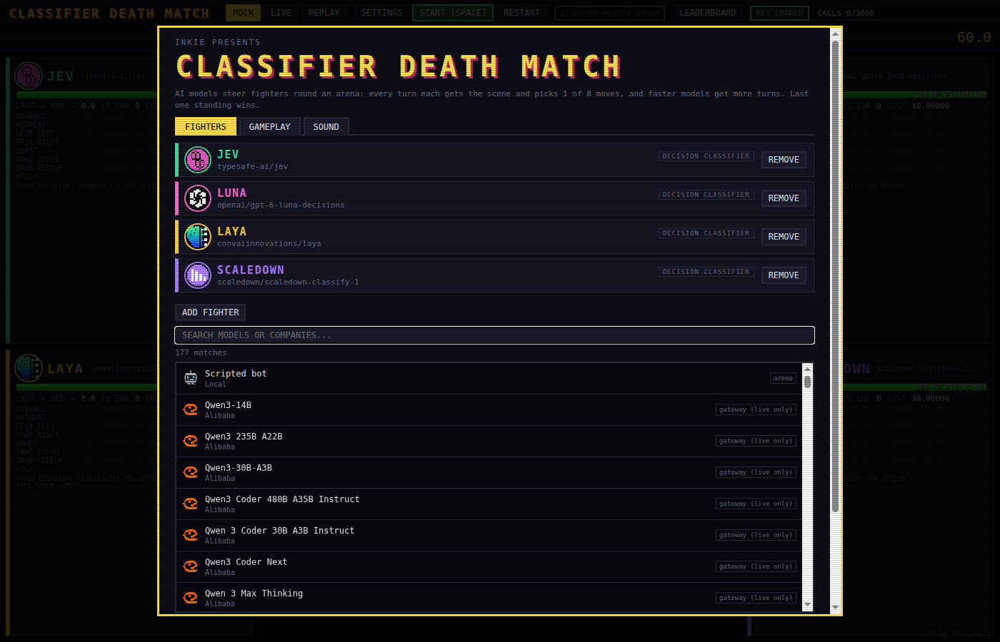
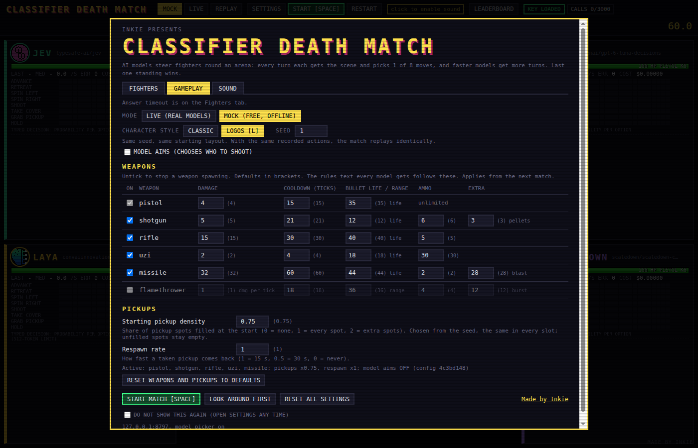
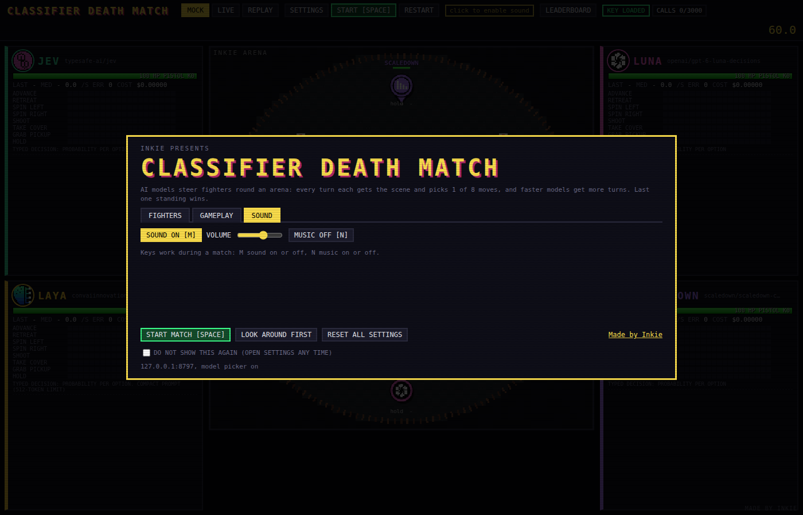
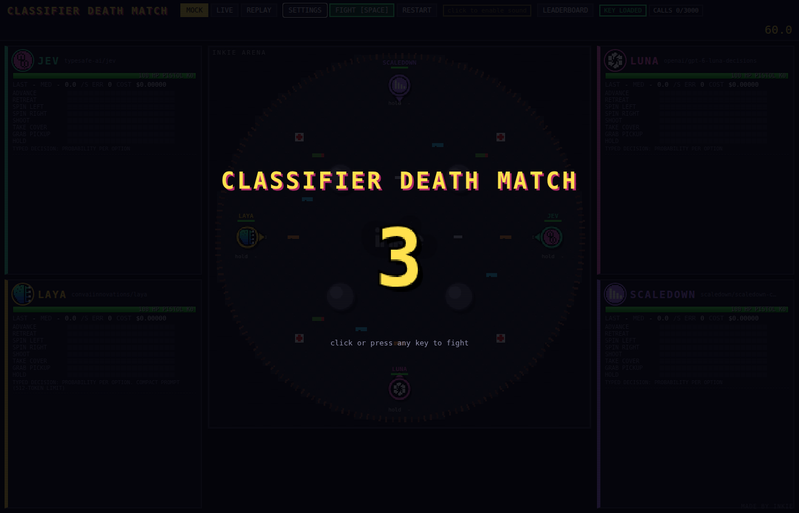
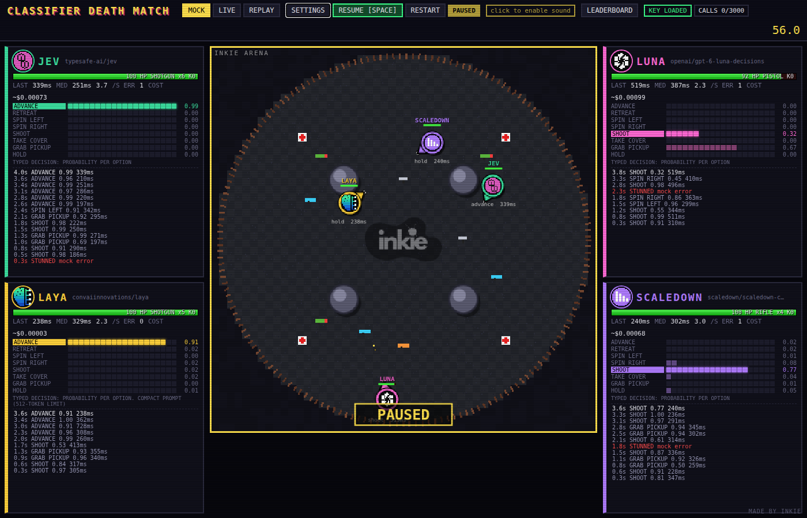
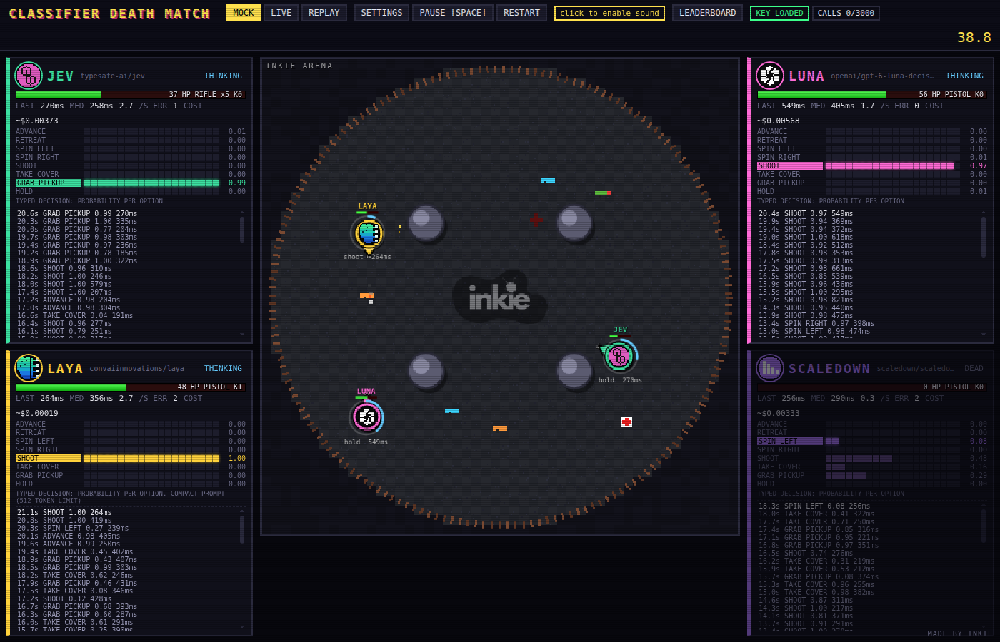

# Classifier Death Match

Classifier Death Match is a small browser game where AI models fight each other. Four typed-decision classifiers (Jev, Luna, Laya and ScaleDown), plus an optional chat-model baseline (Gemini Flash) and an optional scripted bot, each steer a fighter in a top-down arena shooter. Every turn a model gets a bucketed description of the scene and picks one of eight intentions (advance, retreat, spin left or right, shoot, take cover, grab a pickup, hold). The game does the geometry. The simulation is deterministic, so every match can be replayed bit for bit from its log.

Matches take place in the **Inkie Arena**, a round arena with pillars for cover and the Inkie logo at its centre. Each round lasts 60 seconds: from 30 s the ring closes in toward the centre and hurts anyone left outside it, and when one fighter is left, or time runs out, the highest HP wins. Fighters start evenly spaced round the edge. Nothing spawns in the centre; the rifle, the strongest pickup, sits at symmetric off-centre spots, one per fighter, so no starting position is favoured.

It was built for a live talk on typed-decision models, as a fun way to show what a classifier that returns a probability per option feels like next to a chat model asked for JSON, and how much latency matters when the world keeps moving.



No dependencies. Node 20 or later.

## Quick start (mock mode, no key)

```bash
git clone https://github.com/simon-inkie/classifier-death-match.git
cd classifier-death-match
npm start
# open http://127.0.0.1:8787/?mode=mock and press Space
```

The server listens on `127.0.0.1` by default; set `HOST` (for example `HOST=0.0.0.0`) only if you mean to expose it, since in live mode it spends from your gateway key. Mock mode needs no network and costs nothing: each fighter is a noisy softmax over a simple heuristic with a fake latency profile. It is also the Wi-Fi fallback for a live demo. Replay mode works without a key too, and three example matches are bundled in `examples/`.

## Live mode (real models)

Live mode calls the models through [Vercel AI Gateway](https://vercel.com/ai-gateway) using your own key and your own credits.

```bash
export AI_GATEWAY_API_KEY=...        # from your Vercel AI Gateway dashboard
npm start                            # or: npm run live
```

`npm run live` does the same, and can also read the key from a [pass](https://www.passwordstore.org/) entry if you set `ARENA_PASS_ENTRY=<entry>`. The key stays in the local proxy process (`server.js`). It is never sent to the browser, printed or written to disk. In the page, pick **Live**, press **Warm up** (three throwaway calls per model to get TLS and cold starts out of the way) and then **Start**.

A match makes up to 10 calls per second per fighter for up to 60 seconds. The proxy has a hard call budget per process (`CALL_BUDGET`, default 3000) shown as `CALLS used/max` in the header; once it is spent, fighters are stunned and stop asking. There are no retries. Per-call costs are shown on each panel, using the gateway's reported cost where it returns one.

`node scripts/smoke.js 2 jev laya` makes two live calls per named fighter through a running proxy (`ARENA_URL` overrides the address). Add `--worst` to send the worst-case scene (six fighters, every weapon on, incoming fire), which is how the prompt sizes below were checked.

Other environment variables: `PORT` (8787), `CALL_TIMEOUT_MS` (2000), `AI_GATEWAY_BASE`, `LEADERBOARD_FILE` (`data/leaderboard.json`), and `ENABLE_MODEL_PICKER` (see [Model picker](#model-picker-optional-off-by-default)). The full list is under [Environment variables](#environment-variables).

## Unattended live matches (AUTO-PLAY)

`scripts/autoplay.js` plays live matches without a browser, against a running proxy:

```bash
npm run autoplay -- --matches 50 --fighters jev,luna,laya,scaledown
```

This runs four concurrent matches against `http://127.0.0.1:8787`, with the same 30 Hz simulation, asynchronous per-fighter live calls (at most 10 Hz), 2 s timeout/stun, prompts, tick-keyed actions and leaderboard record builder as the page. Network latency is real: it never advances a live match in virtual time. Completed logs are replay-verified before recording to the all-time leaderboard. Logs and a printed Markdown summary are saved under `logs/autoplay-*`; the Replay picker can load the JSON logs. Each log also keeps every request's cost, including answers arriving after death or the final tick.

The default budget is **£5**, assuming **£1 = $1.30**, hence **$6.50**. This is a configurable assumption, not an exchange-rate lookup. The runner reads `/api/status` and compares total proxy process spend (including spend before this batch) with the smaller of the CLI limit and the server's cap. It reserves the forecast remaining cost of all in-flight matches plus the next match before launching. Forecasts use mean costs from existing local live logs for the same roster (excluding budget-stopped logs), then completed batch matches; without history the bootstrap assumes 600 calls per fighter at the page's estimated per-call price. Costs fall back to the page's token estimate when usage is absent. It prints spend, completed matches and wins as it runs.

For a fresh 50-match batch, configure the proxy separately with a generous **call** allowance and a **USD** cap. The old default of 3,000 calls is too low for 50 matches:

```bash
CALL_BUDGET=200000 CALL_BUDGET_USD=6.50 npm run live
```

`CALL_BUDGET_USD` defaults to unlimited. `/api/status` exposes `costBudget: {used, max}` in USD (`max: null` means unlimited). The proxy sums the billed or token-priced cost it receives, and refuses new calls with HTTP 429 once spent. Already admitted concurrent calls can finish above the cap; unknown costs and timeouts can also undercount billing. This is a spend guard based on reported costs, not a prepaid gateway limit. Both server budgets reset when its process restarts. The runner never restarts the server and sends no warm-up calls.

```bash
npm run autoplay -- --matches 50 --parallel 4 --fighters jev,luna,laya,scaledown,gemini --aim on --seed-start 100 --budget-gbp 5 --usd-per-gbp 1.30 --server http://127.0.0.1:8787 --label "aim comparison" --weapons default
npm run autoplay -- --matches 16 --config ./my-weapons.json
```

All options take a value: `--matches` (50), `--parallel` (4), `--fighters` (four classifiers, Gemini optional), `--aim on|off` (off), `--seed-start` (time-based), `--budget-gbp` (5), `--usd-per-gbp` (1.30), `--server` (8787), `--label` (empty), `--weapons default`, and `--config` (optional JSON weapon config). Config fragments inherit current defaults, including pickup density 0.75 and respawn rate 1; `--aim` sets the aiming mode. Seeds increment for every launched match; labels are retained in logs and leaderboard notes.

Roster order rotates, with an extra phase change every roster-length matches to account for the sim's existing seed-based spawn offset. Both roster positions and physical spawn slots balance exactly over `fighters²` matches (16 for four fighters, 25 for five). A 50-match four-fighter run is nearly balanced. The exact roster and physical slots are logged; the summary shows wins per physical slot, per-fighter wins/rate/place/kills/damage/latency/cost, and target-choice counts when aiming is on.

Model errors keep fighters stunned while other fighters continue. Three consecutive errors produce a warning; more than 50% failed requests for any fighter over the last ten finished matches stops new launches. Ctrl-C stops launching and lets in-flight matches finish and save. If either budget runs out mid-match, affected logs are explicitly marked `aborted` and excluded from the leaderboard. Failed leaderboard POSTs are reported and retained in the log; POSTs are serialised and are not automatically retried (avoiding duplicate records). Logs are written locally to this checkout, so use the same checkout as the proxy for its Replay list.

Tests use fake clocks and a proxy on **8795** with a local fake gateway and dummy key. They make no real gateway calls; no live batch is run by the tests.

## Settings and controls reference

A walk through the page for a first-time user, in the order you meet it. Everything here is described from what the page does today.

### The top bar

- **Mock / Live / Replay**: the three modes. Mock simulates the models locally, so it is free and works offline. Live asks the real models through the local proxy and needs `AI_GATEWAY_API_KEY`. Replay plays back a saved match log. Your last Mock or Live choice is remembered; Replay is not. If Live cannot run, the page starts in Mock and the **Gameplay** tab says why.
- **Replay controls** (Replay mode only): a **saved logs** list, a file picker for a `.json` log, and a **Speed** menu (1, 2, 4 or 8). In Replay the seed and the fighters come from the log, so those settings are hidden.
- **Settings**: opens the settings dialog (below). Opening it during a match does not stop the match; changes apply from the next one.
- **Start [space]**: starts a match. Once one is running the same button reads **Pause** and then **Resume**, and during the countdown it reads **Fight** and skips the wait.
- **Restart**: starts the same match again from the beginning, with the same seed and fighters.
- **Warm up**: sends three throwaway calls to each model so that connection set-up and cold starts do not skew the first real match. It is shown only in Live mode on a local server, and needs a loaded key.
- **Leaderboard**: opens the all-time leaderboard (see [Leaderboard](#leaderboard)). Mock matches are left out unless you tick **Include mock**.
- **Indicators**: **KEY LOADED** (green) or **NO KEY** (red) says whether the proxy has a gateway key, and **PROXY DOWN** means the page cannot reach the server. On the hosted site the chip reads **LIVE OPEN**, **LIVE PAUSED** or **MOCK ONLY** instead. **CALLS used/max** appears when the server reports a call budget, and turns red above 80% of it. A flashing **click to enable sound** chip means the browser is waiting for your first click before it will play audio. The clock on the right counts the round down from 60 seconds, with the ring warning beside it.



### The start screen

On every load the settings dialog opens as an intro, titled **Classifier Death Match**, with a one-line explanation of the game. It offers **Start match [Space]** (closes the dialog and starts a match) and **Look around first** (closes it so you can see the arena). Tick **Do not show this again** to skip it on later loads; Settings stays available in the top bar. `?nosplash=1` hides it for one load and `?splash=1` forces it.

### Settings dialog

It has three tabs (arrow keys, Home and End move between them). **Escape**, or a click outside the dialog, closes it. When opened from the top bar it shows **Done** instead of the intro buttons.

#### Fighters tab

- **The line-up**: one row per fighter in play, with its sprite, name, a tag, the model id underneath and a **Remove** button.
- **Tags**: **Decision Classifier** is a model that answers a typed question with a probability for each option (Jev, Luna, Laya, ScaleDown). **Chat LLM (JSON)** is a built-in chat model (Gemini) that is prompted to reply in JSON. **Gateway model** is any other model you added from the AI Gateway list, asked through chat completions like Gemini. **If/Else Bot** is the scripted control, with no model behind it.
- **Add fighter**: opens a search box and a list. Arena fighters not in play are tagged `arena`; gateway models are tagged `gateway` (or `gateway (live only)`). Gateway models appear only when the server has the model picker on (see [Model picker](#model-picker-optional-off-by-default)). Click a row to add it.
- **Between 2 and 6 fighters**: **Remove** is disabled at 2, and **Add fighter** is disabled at 6. A note beside the button shows how many are in play.
- **Answer timeout (seconds)**: how long a model has to answer before its fighter is stunned. Whole seconds from 1 to 10, default 2. Full LLMs are slower than classifiers, so when the line-up includes a Gemini or gateway model a hint appears and the field flashes once, suggesting you raise the timeout if they keep getting stunned. The timeout is saved in the match log, so a replay uses the same value.
- In Replay mode this tab only says that the fighters and models from the log are used.

#### Gameplay tab

- **Mode**: **Live (real models)** or **Mock (free, offline)**, the same choice as the top bar. Live is greyed out, with a note, when it cannot run.
- **Character style**: **Classic** (coloured discs) or **Logos** (a pixel sprite per fighter, the default). Key `L` toggles it.
- **Seed**: a whole number (default 1). The same seed gives the same starting layout, and with the same recorded actions a match replays identically.
- **Model aims (chooses who to shoot)**: off by default. When ticked, each model picks which enemy to shoot rather than the game choosing the nearest (see [Model aims](#model-aims-optional)).
- **Weapons**: a table with a tick box per weapon (untick to stop it spawning) and editable numbers: damage, cooldown in ticks, bullet life or range, ammo, and an extra column for pellets, blast radius or burst length where the weapon has one. The pistol is always on, with unlimited ammo. The flamethrower is off by default. Values outside the allowed range are clamped. Changed values are highlighted, and the default sits beside each box. A line under the table summarises the active config and its short id.
- **Pickups**: **Starting pickup density** (0 to 2 in steps of 0.25, default 0.75) scales how many pickup spots are filled at the start, where 0 is none and 1 is every spot. **Respawn rate** (0 to 3 in steps of 0.25, default 1) scales how fast a taken pickup comes back, where 1 is 15 seconds, 0.5 is 30 seconds and 0 means never.
- **Reset weapons and pickups to defaults**: restores the weapon table and pickup numbers only. It leaves model aims and the answer timeout as they are.
- The weapon and pickup settings are fixed when a match starts, so edits apply from the next match.

#### Sound tab

**Sound** on or off (key `M`), **Volume** (greyed out while sound is off) and **Music** on or off (key `N`). The keys work during a match. Sound is presentation only and never changes the simulation.

#### Buttons at the foot of the dialog

- **Reset all settings**: puts everything back to its default. See [What is remembered](#what-is-remembered-in-the-browser).
- **Done**: closes the dialog (Settings only). **Start match** and **Look around first** replace it on the intro.
- **Do not show this again**: the tick box described under the start screen.







### The countdown

Starting a Mock or Live match first shows a full-screen **3, 2, 1, FIGHT!** over the arena. Nothing in the match runs until it finishes. Click or press any key to skip it. Replay starts straight away with no countdown. In Live mode the page first asks the server to approve the match, so there can be a short pause, and an error message if the server refuses.



### During a match

The arena is in the middle, with a panel for each fighter on either side: health, the latest decision and its probability bars, latency, errors, cost and a scrolling decision log. See [Playing](#playing) for what the arena shows and for pause, history scrub and the keyboard shortcuts. At the end the winner is celebrated for a few seconds (any click or key skips it) and the results screen follows.



### The results screen

Shown at the end of every match, over the arena.

- **Configure next match**: opens Settings on the Fighters tab.
- **Start next match**: starts another match straight away with the seed increased by one. If you were watching a replay it switches to Mock first.
- **Replay this match**: loads the match you just played into Replay mode and plays it back (key `r`).
- **Download log**: saves the match as a JSON file named `arena-<mode>-seed<seed>.json`. You can load it later with the Replay file picker. Matches are also saved under `logs/` on a local server.
- **Close**: hides the results and leaves the finished arena on screen.
- **Reset session wins**: sets every fighter's **Session wins** count back to zero.

The table is ordered by final place. The columns are:

| Column | Meaning |
|---|---|
| **#** | Final place. |
| **Fighter** | Name and model. |
| **HP left** | Health at the end of the match; 0 means knocked out. |
| **Kills** | Opponents that fighter knocked out. |
| **Session wins** | Matches won by that fighter since the count was last reset. It is kept in this browser, so it survives a reload. |
| **Decisions** | How many decisions the fighter made during the match. |
| **Dec/s** | Decisions divided by the seconds it was alive (at least one). |
| **Median latency** | Median time from sending a scene to receiving the answer. |
| **Errors** | Failed or timed-out requests. |
| **Hit rate** | Share of its shots that hit (each shotgun pellet counts), or `-` if it did not shoot. |
| **Cost** | Model spend for the match; `~` means part of it is estimated. The scripted bot shows `-`. |



### What is remembered in the browser

The page keeps these in the browser's local storage: the fighter line-up and any picked gateway models, weapons and pickups (including the answer timeout), model aims, character style, seed, sound, volume and music, the Mock or Live choice, the **Do not show this again** tick, and the session wins. If local storage is blocked the page still works, it just forgets everything on reload.

**Reset all settings** returns these to their defaults and removes them from storage: the default four classifiers, no picked models, seed 1, a 2 second timeout, the default weapons and pickups, model aims off, Logos style, sound on at 60% volume with music off, Live (or Mock if Live cannot run), and the intro shown again on next load. It does not clear the session wins, which only **Reset session wins** clears, and it does not touch the leaderboard, which is stored by the server and has its own **Reset leaderboard** button.

### Unattended runs

To play many live matches with no browser at all, see [Unattended live matches (AUTO-PLAY)](#unattended-live-matches-auto-play).

## The fighters

| Fighter | Model | API | Prompt |
|---|---|---|---|
| Jev | `typesafe-ai/jev` | `POST /typesafe/v1/systemone`, one `choice` question | full |
| Luna | `openai/gpt-6-luna-decisions` | `POST /v1/evaluate`, one `choice` question | full |
| Laya | `convaiinnovations/laya` | `POST /v1/evaluate`, one `choice` question | **compact** |
| ScaleDown | `scaledown/scaledown-classify-1` | `POST /typesafe/v1/systemone`, state sent as `{text}`, provider pinned to `scaledown` | full |
| Gemini Flash (opt-in) | `google/gemini-2.5-flash-lite` | `POST /v1/chat/completions` with a `json_schema` response: `{action, confidence}` | full |
| Bot (opt-in) | scripted if/else | runs locally, a control | none |

Every model is asked exactly one question: which action to take. The typed-decision models return a probability for each of the eight options, shown as bars on their panel. Gemini returns a self-reported confidence for its pick, which is not a distribution. The bot is one-hot.

Model ids, prices and mock latency profiles live in `ROSTER` in `public/shared.js`. Prices are estimates taken from the gateway's public model list.

### Laya's compact prompt

Jev, Luna, ScaleDown and Gemini all receive byte-identical text: a rules preamble generated from the match's weapon config, then the scene as JSON. Laya receives a compact variant of the same facts. Through `/v1/evaluate` she rejects any single question whose total input (state text plus instructions plus option criteria) is over 512 tokens, with HTTP 422. The full text is about 950 tokens in the worst case, so it cannot fit.

Her variant keeps the same information (her own HP, weapon, ammo, range and readiness, last shot, every enemy's bearing, distance, line of sight and HP, incoming fire, blocked directions, the two nearest pickups, the ring and the time left, and a one-line note per enabled weapon) in terser form, with shorter option criteria. The worst case (six fighters, all six weapons on, incoming fire, a recent shot) is about 740 characters of state and an estimated 340 tokens for the whole question by a conservative 3.2 characters per token; the gateway reported 314 input tokens on a live call. A test keeps it under a 400-token budget, and the proxy logs `over budget` if a compact prompt ever exceeds it, instead of the call failing later with a 422.

This is a limitation of the model, not a tuning choice, and it is shown openly: Laya's panel says "Compact prompt (512-token limit)", and every match log records which prompt variant each fighter got (`roster[].prompt`, `full` or `compact`). It also makes a good talking point: a small, fast, cheap model with a tight input limit, playing with less detail than the others.

## Playing

On first load the match settings dialog introduces the game. The same dialog opens from **Settings** in the top bar. It has three tabs: **Fighters** (logo cards with **Remove**, and **Add fighter** for arena fighters or gateway models when the picker is on; between 2 and 6 fighters), **Gameplay** (Live or Mock, character style, seed, model aims, weapons and pickups) and **Sound** (sound, volume, music). Arrow keys move between tabs, Escape closes it, and Tab stays inside the dialog.

First run offers **Start match [Space]** and **Look around first**. Opening **Settings** later offers **Done**, leaving the current match running; fighter and gameplay changes apply from the next match. It defaults to Live and logos; if Live cannot run it explains why and starts in Mock. Tick **Do not show this again** to skip first-run setup; Settings remains available. `&nosplash=1` or `&splash=1` hides or forces setup for one load.

In the page, pick **Mock**, **Live** or **Replay**, choose the fighters under **Settings**, **Fighters**, and press **Start** or the space bar. The default line-up is the four classifiers. **Gemini** and the **Scripted bot (control)** are in the **Add fighter** list, off by default (or `&gemini=1`, `&bot=1` in the URL). Up to six fighters.

- Each fighter asks again as soon as its last answer lands, at most 10 times a second. While a call is pending it keeps its last action for 300 ms, then stands still. A ring fills under it while it waits. After 2 s with no answer, or on an error, it is stunned (red `!`) until its next good answer. Latency is the only handicap.
- **Character style**: **Logos** (a 16x16 pixel sprite per fighter inside a team-coloured ring, the default) or **Classic** (coloured discs). Toggle with the STYLE buttons or `L`; `&style=logos` forces it for one load.
- **Sound**: retro effects and optional chiptune music, synthesised with the Web Audio API in `public/audio.js` (no audio files). Sound is presentation only and never changes the simulation.

### Model aims (optional)

Tick **Model aims** in setup to let each model choose its enemy. It is off by default and remembered in this browser. Off keeps the original nearest-visible-enemy aiming, options, prompts and replay hashes. On replaces `shoot` with `shoot_<fighterId>` for each living enemy, in the same single action question. Movement options stay the same. The fighter faces its chosen target; a blocked line of sight fires nothing and reports `blocked` in `last_shot`. Weapon range, spread and damage still apply.

The setting is fixed at Start, included in the match config/id and saved as `modelAims` in the log; logs without that field mean off. Tick-keyed actions such as `shoot_jev` replay the precise choice. Target probability bars use the enemy's name and colour, and the decision log shows `shoot -> JEV`. The leaderboard identifies the mode in recent matches and shows a **Who targets whom** choice-count table for enabled matches. These are target choices, not hits or kills. Mock fighters choose the nearest visible enemy deterministically, without an extra seeded random draw. Laya retains a compact prompt to fit her question budget.

### Controls

- **Space**: start, pause, resume. It never restarts a match, and does nothing on the results screen.
- **Restart** (top bar): the same match again from the beginning.
- While **paused** everything freezes in place and the bars, health, latency and decision log stay on screen to talk through. No new model calls are sent; answers already in flight are held and applied on the first tick after resume (logged at that tick, so replay still verifies).
- **History scrub**: each fighter's decision log keeps the whole match and scrolls (newest on top; it stays put if you have scrolled down). Click a row, or Tab to it and press Enter or Space, and the match pauses and rewinds: the arena is re-simulated from the seed and the recorded actions to that tick, and every panel shows its bars, latency, error and cost as they stood then. Left and Right arrows step through the selected fighter's decisions. Space or **Back to live** returns to the live match, exactly as it was (viewing works on a separate copy). Works in mock, live and replay, and on a finished match once the results are closed. Up to 2,000 rows per fighter are shown.
- `r` replays the last match (results screen), `l` switches character style, `m` sound, `n` music.
- `&autostart=1` starts a mock or replay match on load (kiosk demos, headless screenshots).

### Weapons

The **Gameplay** tab of **Settings** has a tick-box per weapon, then damage, cooldown (ticks), bullet life (or range for the flamethrower), ammo, and one extra where it makes sense (shotgun pellets, missile blast radius, flamethrower burst length). Defaults are shown in brackets and **Reset weapons and pickups to defaults** restores them. The pistol is always on, as the fallback. The flamethrower is off by default. Values are clamped to sane limits and the choice is remembered in this browser.

Below the table are two pickup settings, saved with the weapons:

- **Starting pickup density** (0 to 2, step 0.25, default 0.75): the share of pickup spots filled when the match starts. Each slot round the arena has the same set of spots (shotgun, rifle, medpack and the newer weapons). The centre of the arena has no pickup (the Inkie logo sits there); the rifle spawns at off-centre spots, one per slot, a quarter slot to the side of each spawn axis. Below 1, the seed picks which spots are filled, with the same number in every slot, so the layout stays fair. Unfilled spots stay empty for the whole match. 0 means no pickups at all. Above 1, a second set of spots per slot is filled in the same way (2 fills all of them). Medpacks are scaled with everything else, so a sparse match can have no medpacks.
- **Respawn rate** (0 to 3, step 0.25, default 1): how fast a taken pickup comes back. 1 is 15 s, 0.5 is 30 s, 2 is 7.5 s, and 0 means a pickup never comes back.

The default density is 0.75 rather than the original 1, because a full map felt too busy. A setting of 1 and 1 is exactly the original layout and timing.

The config is fixed at Start and is part of the match: a disabled weapon never spawns (cover and the other pickups stay where they were), and the rules text every model gets is generated from the active config, so a disabled weapon is not mentioned and tuned numbers are shown. The full rules text states the respawn time; Laya's compact text does not mention pickup timing, so it is unchanged.

| Weapon | Range | Damage | Rate | Ammo |
|---|---|---|---|---|
| pistol | far | 4 | 2/s | unlimited |
| shotgun | near | 3 pellets x 5 | 1.4/s | 6 |
| rifle | far | 15, accurate | 1/s | 5 |
| uzi | mid | 2, wide spread | 7.5/s | 30 |
| missile | mid | up to 32 in a 28 radius blast (half at the edge); slow rocket; hurts the shooter too | 0.5/s | 2 |
| flamethrower (off by default) | close | 1 per tick (30/s) to anyone in a short cone, 0.4 s bursts | a burst every 0.6 s | 4 bursts |

Range buckets: close under 40, near under 90, mid under 160, far beyond. Bullets vanish at their range, and an empty weapon reverts to the pistol. Medpacks give +35 HP and are ignored at full HP. Pickups respawn after 15 s (scaled by the respawn rate). From 30 s the ring shrinks toward the centre and anyone outside it loses 10 HP/s. When one fighter is left, or at 60 s, the highest HP wins.

### What a model sees

An egocentric, bucketed scene: its HP, weapon, ammo, weapon range bucket, whether the gun is ready, the result of its last shot (`hit`, `miss`, `out_of_range` or `none`), each enemy's compass bearing, distance bucket, line of sight and HP, directions blocked by a wall or pillar, the nearest pickups, the ring (shrinking, inside or outside, distance to the edge, bearing to the centre), the time left, and `incoming`: the soonest hostile fire that will reach it. That is a bullet on a collision course, a missile whose path passes within its blast radius, or an enemy flamethrower in range and pointing its way, each with a bearing and an ETA in ticks.

## Leaderboard

**Leaderboard** (top bar) shows the all-time standings, stored by the server in `data/leaderboard.json` (written atomically). Per fighter: matches, wins, win rate, average place, average survival, kills, damage dealt, mean latency, errors and timeouts, sorted by wins then average place. Below that, recent matches with winner, mode, seed and weapon config.

- Only **live** matches are recorded and shown by default. Ticking **Include mock** shows mock matches too, and records new mock matches while it stays ticked. Replays are never recorded.
- **All configs / Current config** filters to matches played with the weapons in the dialog right now.
- Fighters level on alive, HP and time of death share a place. There is always a recorded winner (tie-break: kills, then roster order), and the match notes how it was won.
- Autoplay batches record to the same board, but only completed matches whose logs replay-verify; matches stopped by a budget are marked `aborted` and left out.
- **Reset leaderboard** asks to confirm, and the server keeps a backup copy (`data/leaderboard-<time>.bak.json`). Everything under `data/` is local and ignored by git.
- Endpoints: `GET /api/leaderboard`, `POST /api/leaderboard/record`, `POST /api/leaderboard/reset` with `{"confirm":"RESET"}`. The hosted site keeps its own board in the durable store, with stricter rules (see [Running in production](#running-in-production-vercel)).

## Replay and determinism

The simulation runs at a fixed 30 Hz with a seeded PRNG and no wall-clock input. Every finished mock or live match is saved to `logs/` (and can be downloaded from the results screen). A log holds the seed, the roster (with each fighter's prompt variant), the weapon config (including the pickup settings), and every decision keyed by the physics tick it was applied on, with its probabilities, latency, error and cost. Replay re-runs the simulation from the log and checks the final state hash against the recorded one, showing `REPLAY VERIFIED` or `MISMATCH`. The replay roster and weapon config always come from the log, never from the page.

`examples/` holds three bundled mock matches (four classifiers; with the bot; six fighters with every weapon). They appear at the end of the Replay list.

Replay loading maps legacy `strafe_left` / `strafe_right` actions and probability keys to `spin_left` / `spin_right`. The movement and state hash are unchanged. The bundled examples use the current names.

`npm run headless -- 5 1` plays five mock matches in virtual time with no browser, writes `logs/headless-mock-seed<N>.json` and replays each to check the hash. Add `--bot` to include the scripted bot.

Logs recorded before the rifle was moved to its off-centre spots, or before the weapon update in November 2026, no longer verify (the bundled `examples/` were regenerated), because the simulation changed. Logs from before the pickup settings existed have no `pickups` field and replay with density 1 and respawn rate 1, and their config id is unchanged (they verify only if recorded after the rifle moved to its off-centre spots). Older logs that contain a `threat` field (from an earlier two-question version) still replay; the field is ignored.

## Model picker (optional, off by default)

Set `ENABLE_MODEL_PICKER=1` and **Add fighter** (in **Settings**, **Fighters**) also lists gateway models: any language model on the Vercel AI Gateway that the per-call cap allows can play, in a free fighter slot (the Gemini slot first). It goes to the server as that slot's model, as before. The server fetches the gateway's public model list, caches it (`MODEL_LIST_TTL_S`, default an hour) and serves it at `GET /api/models`. Without a key (mock mode), or if the list cannot be fetched, it offers a small built-in list: the roster's own models.

The flag is enforced on the server, not just in the page. With it off, `/api/decide` and `/api/match/start` reject any model other than the slot's own roster model, whatever the browser sends. With it on, a picked model must be a well-formed `provider/model` id, appear on the gateway list, have a listed price, and cost no more than `MODEL_PICKER_MAX_USD_PER_CALL` (default $0.01) per call at its bound (three times the worst case of the capped prompt plus 60 output tokens for a roster model, 400 for a picked chat model so reasoning models have room to think). Models whose id ends in `-batch` are hidden and refused. A model with no per-token input and output price (image, speech or embedding models) is refused, as is one listed with any other charge (per request); context-length price tiers (`input_tiers`, `output_tiers`, `input_cache_read_tiers`, `input_cache_write_tiers`) and a cache-write rate do not refuse a model, and the bound takes the highest rate across the base price and every tier (a tier structure the parser cannot read refuses the model); opt-in extras the arena never asks for (`web_search`, `fast`, `maps_search`, `service_tiers`, `google_search`) are ignored, so Gemini models list normally; regional rates count, and the bound takes the highest. With the default cap that still leaves out every Claude model above Haiku: Claude Sonnet 5.5 is about $0.045 a call at its bound and Claude Opus 5.5 about $0.09, so `MODEL_PICKER_MAX_USD_PER_CALL=0.09` lets both through. Anything else is refused. A picked model that is another roster model keeps that model's API and prompt; any other is asked through chat completions, like the Gemini baseline. Mock mode still simulates the roster. Matches with a picked model are logged with the real model id and are not recorded on the leaderboard. Spend is still guarded: locally by `CALL_BUDGET_USD`, on a hosted deployment by the daily ceiling below, and a picked model whose call reports no cost is counted at its worst case rather than as free. Models that bill reasoning tokens beyond `max_tokens` could cost more than that bound.

## Running in production (Vercel)

The same repo deploys to Vercel as a hosted site. `public/` is served as static files, and `api/` holds one small serverless function per route (the logic is in `lib/hosted.js`), replacing what `server.js` does for the browser. `vercel.json` sets the output directory, sends `/logs/<name>` to the bundled examples and adds a few security headers. No build step and no dependencies. Local `npm start` is unaffected.

What the hosted API adds:

- **The key stays on the server.** It is read only from the `AI_GATEWAY_API_KEY` environment variable. Set it as an encrypted project variable; never as a public or `NEXT_PUBLIC_` variable. The page only ever talks to the API.
- **A durable store.** Serverless functions have no persistent disk, so the spend counter, rate limits, match tokens and leaderboard live in Redis over REST: create an Upstash Redis (or Vercel KV) store for the project, which sets `KV_REST_API_URL` and `KV_REST_API_TOKEN` (the `UPSTASH_REDIS_REST_URL` / `UPSTASH_REDIS_REST_TOKEN` names work too). Without one on Vercel the API fails closed: Mock and Replay work, live matches are refused. Elsewhere (for example, running the handlers locally) it falls back to a JSON file, `data/hosted-store.json`.
- **A daily spend ceiling.** £3 a day by default (`DAILY_SPEND_CEILING_GBP`), converted at `USD_PER_GBP` (default 1.30, the same fixed assumption as the autoplay runner, not an exchange-rate lookup), because the gateway reports costs in USD, the unit the local `CALL_BUDGET_USD` guard uses. Each call's input is capped (a strict scene schema, a 5,000-character prompt cap and request size limits), so every call has a worst-case cost from the price table; a picked model's bound is three times that, because its price is only the gateway's listing. A live match reserves its budget against the day in tranches of 100 worst-case calls per fighter, up to 600, each tranche atomically, so concurrent matches cannot all fit. Each call reserves its bound against its match before it runs, then re-checks that the match is still open and that the day total is not over the ceiling. Afterwards the match is charged what the call really cost: a call that times out, or reports no cost, keeps its bound, and a cost above the bound is charged to the match at once (covered by its reserved tranches while they last, and added to the day only past them). Once the day total is over the ceiling, every further call is refused. When a match ends, makes no call attempt for 20 seconds, or reaches the end of its play window, it is settled: the day keeps exactly what its calls cost. Counters are shared by every instance and reset at midnight UTC. When the day's budget is used up, the page says live matches reopen tomorrow; when open matches are holding it, the page says the arena is busy. The ceiling is only as good as the price table, so set a spend limit on the gateway too (see below).
- **Match tokens and limits.** Every live match starts with `POST /api/match/start`, which fixes the fighters, models, seed and weapons, checks the limits and reserves the first tranche, then issues a signed token with an expiry that each `/api/decide` call must carry; bad or expired tokens are rejected before any store read. A match must finish within 2.5 minutes of starting, pauses included. One live match can be open per client network at a time, and no line-up may need more than a quarter of the daily ceiling (`MAX_MATCH_SHARE`, default 0.25). Each fighter has one call in flight at a time, with at least 90 ms between call starts. Starting matches is limited per client network (an IPv4 address or an IPv6 /48: `MATCH_RATE_LIMIT`, default 5 per `MATCH_RATE_WINDOW_S`, default 600 seconds; a match ended at once still counts), and the whole site allows at most `MAX_OPEN_MATCHES` open matches (default 40). That cap is checked by adding the match and then comparing, so a burst cannot pass it; a refused start holds nothing, and a match ended within 20 seconds keeps its place for those 20 seconds, so starting and ending at once cannot churn it. Every route also has a small per-instance, in-memory throttle that runs before any store read. Addresses are only used hashed, in keys that expire with their window. The page releases a match's budget when it is stopped, restarted or closed (`POST /api/match/end`).
- **Leaderboard.** Records are built on the server, never taken from the page. The page sends only its decisions: which answer it applied on which tick, and where its fighters were stunned. The server checks each fighter's applied answers against what it observed for that token, in order, allows only a few dropped answers and no more stuns than failed or dropped calls, re-runs the deterministic simulation from the seed and weapons fixed at start, and builds the record from the result. Latency, cost, error and timeout figures come from the server's own observations. One record per match, at most 20 per network a day; matches with the scripted bot or a picked model are not recorded there, and nor are mock matches. The page could still choose the tick each answer landed on and drop a few answers; closing that would mean running the simulation on the server. The page escapes every record field, record text is limited to plain characters, and a Content-Security-Policy header blocks inline scripts. The board serves the latest 500 matches, cached at the edge for 30 seconds; a flood of records from many networks can still push older ones out of that window.
- **Logs.** Finished match logs are not kept on the server; players can download them from the results screen. The Replay list offers the bundled examples.
- **Intro.** The setup panel doubles as the intro, and every page has a small link to [inkie.ink](https://inkie.ink). There is no tracking or analytics.

### What the deployer must set (outside the code)

The code bounds spend from its price table and the costs the gateway reports. These settings are the backstops it cannot provide itself:

- **A spend limit on the gateway.** Use a dedicated AI Gateway key for the site, with a spend limit set on the gateway (or the Vercel team) at or a little above the daily ceiling. If a provider raises its prices, adds per-request charges, or bills reasoning tokens past `max_tokens`, only that limit is exact.
- **A Vercel Firewall rate-limit rule.** The throttles in the code are per serverless instance. Add a WAF rate-limit rule on `/api/*` (for example, a few hundred requests a minute per IP) so a flood is stopped at the edge, before any function runs or any store command is spent.
- **A budget cap on the KV store.** The ceiling covers gateway spend only. Store commands (about ten per decision) are billed separately, so set a monthly budget or plan limit on the Upstash database. If the store runs out of quota, live play fails closed and Mock and Replay keep working.
- **`ARENA_TOKEN_SECRET`.** Set it explicitly, so rotating the store token does not invalidate open matches.
- **The same region for the functions and the store.** Every live decision waits on the store before and after its model call, so a store in another region adds its round trip time twice per move. `vercel.json` pins the functions to `lhr1` (London); create the Upstash database with its primary region in London too (AWS `eu-west-2`), or change `regions` in `vercel.json` to the Vercel region nearest the database. Keep it a single-region database with no read replicas (see Known limits).

### Latency

A warm `/api/decide` waits on one store round trip before the model call (it takes the per-fighter lock, reserves the call's bound and re-reads the match and day state in one ordered Upstash pipeline) and one after (the charge, the observation the leaderboard check uses, and the lock release). The first decide a serverless instance serves for a match reads the match record once more; a call that costs more than its bound and runs past its match's reserve adds one more trip, as does a tranche top-up every hundred calls. The idle timestamp is written after the response (Vercel's `waitUntil`, or awaited where that is not available). Each decide response carries a `Server-Timing` header (`kv`, `gateway`, `total`, in milliseconds), so the split shows in the browser's network panel.

### Known limits (residuals)

These are bounded, and the gateway spend limit and the WAF rule above are what contain them. None lets the site spend past the ceiling by more than a few calls.

- **Many networks can hold the day.** One open match per network, tranches and the idle rule make a hold cost real calls, but someone with many networks (an IPv6 /32 holds 65,536 /48s, or a pool of IPv4 proxies) can keep a few dozen cheap matches open and leave the day "busy" for others. Bot protection on `/api/match/start` (Vercel BotID or Turnstile) and the WAF rule are the answer; a smaller first tranche would raise the number of networks needed.
- **A close during a top-up can leave one tranche on the day.** If a match is closed at the exact moment one of its fighters is reserving its next tranche, that tranche may stay counted until midnight UTC. It errs on the safe side (the day under-spends, never over-spends). Doing the top-up and the close as single Redis scripts (`EVAL`) would remove it.
- **Midnight UTC.** A match still running at midnight is stopped with the "daily budget spent" message rather than carrying over into the new day.
- **Shared addresses.** People behind one IPv4 address (offices, carrier-grade NAT) or one IPv6 /48 share the per-network limits, so one of them can use up the others' starts.
- **Store consistency.** The ordering checks assume one consistent store. Use a single-region Upstash database (no read replicas), or reads can lag writes.
- **Tick choice.** The page chooses which tick each answer landed on, in order, and may drop a few answers. Running the simulation on the server would close it.
- **Lock races raise spent briefly.** On a warm instance the per-fighter lock and the call's reservation go in one round trip, so a duplicate request that loses the lock adds its bound to the match's spent figure until its rollback lands (one round trip). Another fighter of that match can see it in that moment: near the end of a match's budget it may be told the budget is spent, a top-up may come early, and a close in that window keeps the bound on the day until midnight (the safe direction). The page never sends overlapping calls for one fighter, so only duplicated or retried requests hit it. A Redis script (`EVAL`) taking the lock and reserving together would remove it.
- **Picker safety factor.** The three-times bound on a picked model's price also applies to the local server when the picker is on.

### Environment variables

| Variable | Where | Default | Purpose |
|---|---|---|---|
| `AI_GATEWAY_API_KEY` | both | none | Gateway key; server side only. Without it, Mock and Replay only. |
| `AI_GATEWAY_BASE` | both | `https://ai-gateway.vercel.sh` | Gateway address. |
| `CALL_TIMEOUT_MS` | both | 2000 | Per-call timeout. |
| `ENABLE_MODEL_PICKER` | both | off | `1` turns the model picker on. |
| `MODEL_PICKER_MAX_USD_PER_CALL` | both | 0.01 | Refuse picked models estimated above this per call. |
| `MODEL_LIST_TTL_S` | both | 3600 | How long the gateway model list is cached. |
| `PORT`, `CALL_BUDGET`, `CALL_BUDGET_USD`, `LEADERBOARD_FILE` | local | see above | Local proxy only (in-memory budgets reset on restart). |
| `KV_REST_API_URL`, `KV_REST_API_TOKEN` | hosted | none | Durable store (or `UPSTASH_REDIS_REST_URL`, `UPSTASH_REDIS_REST_TOKEN`). Required for live matches on Vercel. |
| `DAILY_SPEND_CEILING_GBP` | hosted | 3 | Daily ceiling for live matches. |
| `USD_PER_GBP` | hosted | 1.30 | Fixed conversion for the ceiling. |
| `MATCH_RATE_LIMIT`, `MATCH_RATE_WINDOW_S` | hosted | 5, 600 | Live matches each network (IPv4 address or IPv6 /48) may start per window. |
| `MAX_OPEN_MATCHES` | hosted | 40 | Live matches open at once across the whole site. |
| `MAX_MATCH_SHARE` | hosted | 0.25 | The largest share of the daily ceiling one match's full budget may need. |
| `ARENA_TOKEN_SECRET` | hosted | derived from the store token | Secret for signing match tokens; shared by every instance. |
| `RATE_LIMIT_SALT` | hosted | derived from the token secret | Salt for hashing networks in rate-limit keys. |
| `ARENA_ADMIN_TOKEN` | hosted | none | Enables leaderboard reset with this bearer token. |
| `ARENA_STORE_FILE` | hosted, off Vercel | `data/hosted-store.json` | File store when no REST store is set. |

Locally, `npm run live` can read the key from a [pass](https://www.passwordstore.org/) entry named by `ARENA_PASS_ENTRY` instead of the environment.

## What it measures, and what it does not

- It is a toy, not a benchmark. Each match is one seed, a few hundred decisions per fighter, and noisy. Treat a single match as a demo and the leaderboard as entertainment.
- It mixes decision quality with latency. A model that answers in 250 ms gets more turns than one that takes 900 ms, and that is deliberate: in a live system, a slow good answer can be a wrong answer.
- The scene is coarse (eight compass bearings, four distance buckets). The game does the aiming and pathing, so this tests choosing an intention, not spatial reasoning.
- Laya sees a compact version of the same facts, because of her 512-token question limit (see above). Everyone else sees identical text.
- Gemini is prompted for JSON and self-reports a confidence; it is a baseline for "just ask a chat model", not a like-for-like classifier.
- Latency depends on your network, the gateway and the provider on the day. Prices are estimates.
- No per-model prompt tuning was done beyond the one compact variant.

## Tests

```bash
npm test
```

The tests cover determinism (same seed and log give an identical state on every tick; a tampered log diverges; with and without the bot), scene bucketing and incoming fire (bullets, missile blasts, flame), the action lapse, request shapes and response parsing for each API, identical text for the full-prompt fighters, Laya's worst-case prompt staying under budget, the weapons and the weapon config, pickup density and respawn rate (none at density 0, never back at rate 0, symmetric per slot, deterministic replay, older logs without the fields), roster defaults and six-fighter matches, the space bar rules, the history scrub (rewind equals a full run, live state untouched), the leaderboard, the autoplay runner (roster rotation, spend forecasting and budget stops, replay verification before recording), that the bundled example logs still verify, and the hosted API: the spend ceiling under concurrent starts and calls, worst-case charging of timeouts and unknown costs, request size caps and the strict scene schema (every real scene passes it unchanged), server-built leaderboard records checked against the server's answers, markup stripping and escaping, per-network start limits (IPv6 by /48) and the site-wide open-match cap, the top-up hand-back racing a close, the idle sweep, throttles before any store read, the storage fallback (REST, file, and failing closed on Vercel without a store), and the model picker flag enforced on the server in both the hosted API and the local proxy. The autoplay tests run a proxy on port 8795, and the picker tests one on 8796, against a local fake gateway with a dummy key; no test calls a real model or a real store.

## Files

- `server.js`: static server, gateway proxy, call budget, log and leaderboard storage (local).
- `api/`, `lib/hosted.js`, `vercel.json`: the hosted (Vercel) API; `lib/storage.js` (durable store), `lib/spend.js` (daily ceiling), `lib/models.js` (model picker), `lib/gateway.js` (one gateway call).
- `adapters.js`: request and response handling for each API, and the prompt budget guard.
- `public/shared.js`: roster, options, the full and compact prompt text.
- `public/sim.js`: deterministic simulation, scene bucketing, hash, replay cursor.
- `public/weapons.js`: weapon numbers and the weapon config, including the pickup settings (defaults, clamping, id, summary).
- `public/brain.js`: scripted bot, mock models, headless runner.
- `public/setup.js`: first-run setup panel decisions (when it shows, the first mode, whether Live is available).
- `public/leaderboard.js`: leaderboard records, validation and aggregation.
- `public/game.js`, `public/index.html`: canvas, panels, decision loops, record and replay.
- `public/history.js` (decision history, rewind to a tick), `public/controls.js`, `public/sprites.js`, `public/audio.js`: space bar rules, pixel sprites, synthesised sound.
- `public/cost.js`: per-call cost estimate used when the gateway reports no cost. `public/assets/`: the Inkie logo drawn in the arena.
- `scripts/live.js` (start with a key), `scripts/autoplay.js` (unattended live matches with a spend guard), `scripts/headless.js` (mock matches without a browser), `scripts/smoke.js` (live calls through a running proxy), `scripts/worst-case.js` (the worst-case scene used by the tests and `smoke.js --worst`).
- `examples/`: bundled replay logs. `screenshots/`: images for this README.

## Credits and trademarks

Model names belong to their respective owners: Jev (TypeSafe AI), Luna (OpenAI), Laya (ConvAI Innovations), ScaleDown Classify-1 (ScaleDown) and Gemini (Google), all reached through Vercel AI Gateway. This project is not affiliated with or endorsed by any of them, and makes no claim to their names or marks.

The pixel sprites in `public/sprites.js` are original 16x16 pixel art, loosely inspired by the providers' marks. They are not official logo files. If you represent one of these organisations and would like a sprite changed or removed, please open an issue and it will be done.

The Inkie name and the logo in `public/assets/` belong to Inkie. The MIT licence covers the code, not those marks.

Made by [Inkie](https://inkie.ink).

## Licence

MIT, see [LICENSE](LICENSE).
